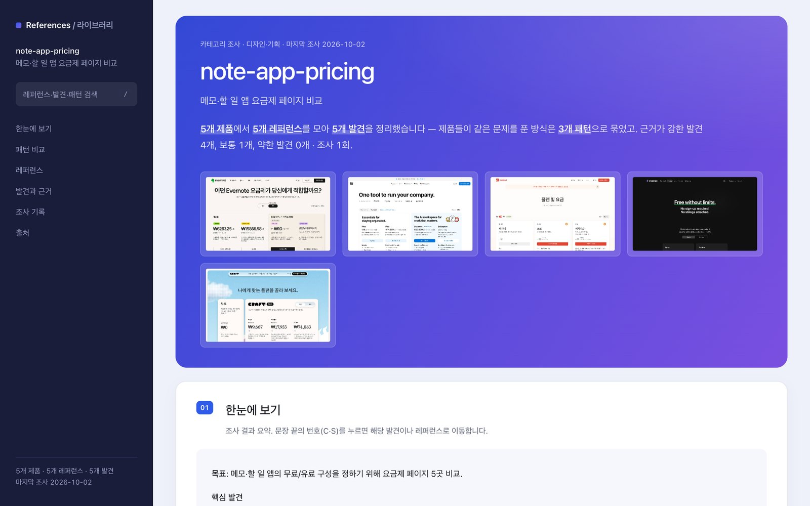
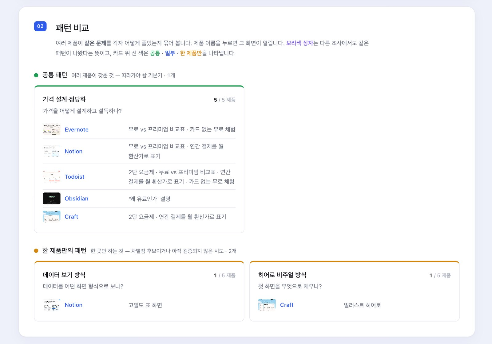
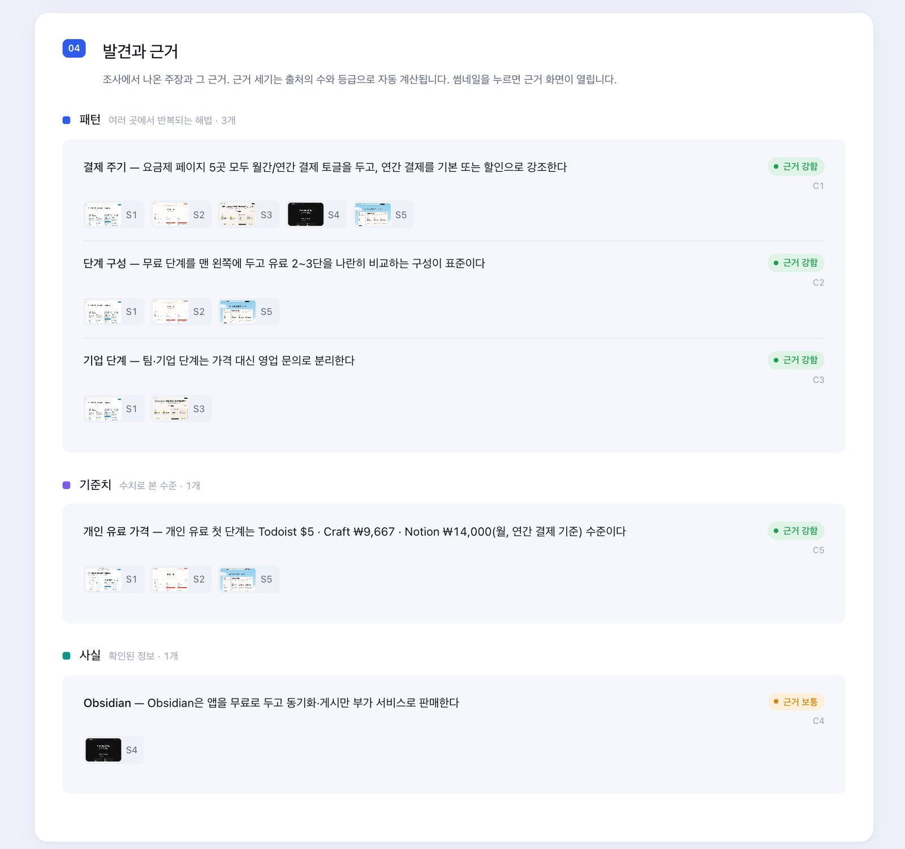
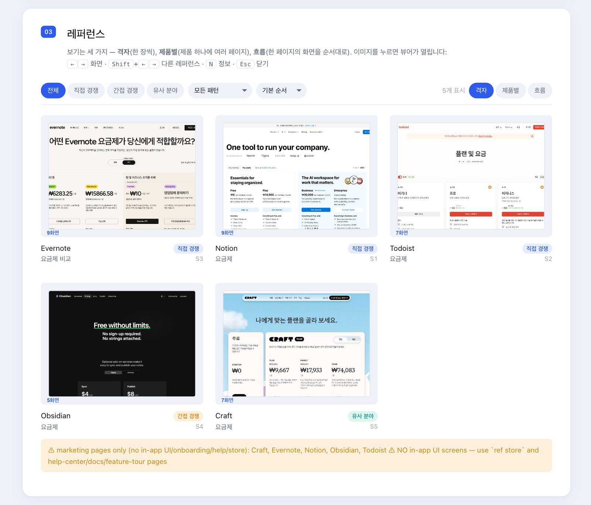
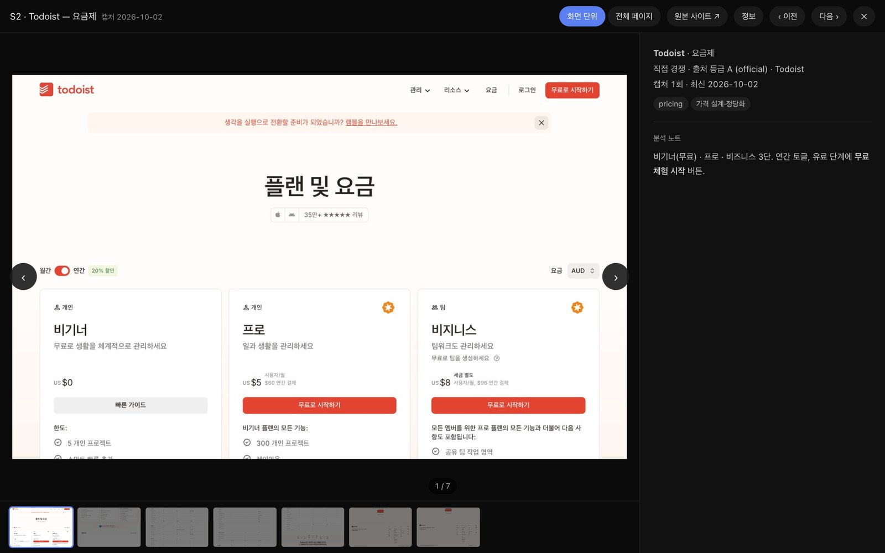

<p align="center"></p>

<h1 align="center">reference-research</h1>

<p align="center"><b>출처가 남는 레퍼런스 조사, Claude Code 안에서</b><br>
비슷한 서비스·경쟁 화면·강의를 찾아 실제 화면을 캡처하고, 발견마다 근거를 붙여 카테고리별 비교 보드로 정리합니다.</p>

<p align="center">


</p>

> **비공개 베타입니다.** 초대받은 분만 써 주세요. 코드는 고치지 말고, 문제나 아이디어는 [피드백](#피드백--문제-보고)으로 보내 주세요.

---

## 왜
- **조사 결과에 근거가 남습니다**: "다들 연간 결제를 할인해 준다" 같은 발견마다 어떤 화면에서 봤는지(S1, S2…)가 붙고, 출처 수와 등급으로 **근거 강함 · 보통 · 약함**을 자동으로 매깁니다.
- **실제 화면을 봅니다**: 페이지를 스크롤하며 화면 단위로 캡처하고, 전체 페이지도 이어 붙입니다. App Store 화면도 받아 옵니다.
- **한 번 모은 자료를 다시 씁니다**: 다른 조사에서 같은 사이트를 만나면 새로 모으지 않고 카테고리만 추가하고, 30일이 지났으면 다시 캡처해 **무엇이 바뀌었는지** 기록합니다.
- **같은 문제를 어떻게 풀었는지 나란히 봅니다**: 제품마다 다른 이름으로 붙은 태그를 공통 패턴으로 묶어 비교합니다.
- **커리큘럼 비교도 됩니다**: 강의들의 주제·시간·순서·빈틈을 비교해 교육 과정을 설계할 때 씁니다.

## 어떻게 동작하나
1. Claude에게 조사를 맡깁니다. 예: "가계부 앱 온보딩 레퍼런스 조사해줘"
2. Claude가 검색으로 후보를 넓게 모은 뒤(보통 12개 이상) 직접 경쟁 · 간접 경쟁 · 유사 분야로 골라냅니다.
3. 고른 페이지를 캡처하고, 화면을 보며 노트와 발견(근거 포함)을 기록합니다.
4. 카테고리별 **보드**(HTML)를 만들고 라이브러리(`~/references`)에 쌓습니다. 다음 조사는 여기서 이어 갑니다.

## 둘러보기
아래 화면은 데모 조사 "메모·할 일 앱 요금제 페이지 비교"(5개 제품)로 만든 실제 보드입니다.

<p align="center"></p>

| 패턴 비교 — 같은 문제, 제품별 해법 | 발견과 근거 — 근거 세기 자동 계산 |
|---|---|
|  |  |
| **레퍼런스 — 격자 · 제품별 · 흐름 보기** | **화면 뷰어 — 화면 단위 · 전체 페이지 · 분석 노트** |
|  |  |

- **한눈에 보기**: 조사 요약. 문장 끝 번호(C·S)를 누르면 해당 발견·레퍼런스로 이동
- **검색(`/`)**: 레퍼런스 · 발견 · 패턴을 한 번에 찾기
- **조사 기록**: 조사할 때마다 새로 생긴 발견, 뒤집힌 발견, 다시 확인된 발견
- **라이브러리 홈**(`~/references/index.html`): 모든 카테고리 목록
- **MCP 연결**: 조사가 아닌 다른 작업 중에도 Claude가 라이브러리를 검색해 근거로 씁니다("지난번 조사에서 한도 표시를 어떻게 했지?")

## 캡처 방식
| 방식 | 조건 | 비고 |
|---|---|---|
| 🟢 Aside | Aside가 설치되어 있음 | 내 브라우저 그대로 캡처(로그인된 페이지 포함) |
| 🟢 Chrome | Google Chrome · Chromium · Edge 중 하나 | 로그인 없이 새 창으로 캡처. 로그인 필요한 페이지는 로그인 화면이 찍힘 |
| 🟡 없음 | 둘 다 없음 | 화면 없이 글 자료(기사·문서)로만 조사 |

자동으로 고릅니다(Aside → Chrome → 없음). 바꾸려면 `REF_CAPTURE=chrome`처럼 지정하세요.

## 설치
**필요한 것**: Claude Code · Node.js 20 이상 · Python 3 + Pillow(`pip3 install pillow`) · Chrome 또는 Aside · git(권장)

1. 메일로 온 **GitHub 초대를 수락**합니다(또는 https://github.com/Y-jae-heon/reference-research/invitations).
   - 비공개 저장소라 터미널에서 GitHub 로그인이 되어 있어야 해요: `gh auth login`
2. Claude Code에서:
   ```
   /plugin marketplace add Y-jae-heon/reference-research
   /plugin install reference-research@reference-research-beta
   ```
3. Claude Code를 다시 시작하고 **"레퍼런스 조사 도구 상태 점검해줘"** 라고 말합니다.
   ```
   ✓ Node 22.x
   ✓ Python + Pillow 12.x
   ✓ capture: headless Chrome — Aside not found, so pages are captured without your logins
   ⚠ embeddings not installed — optional; text search still works
       → ref setup --embeddings   (~700 MB, one time)
   ⚠ library is not a git repo — no history to roll back to
       → ref setup --git
   ```
   ⚠ 항목은 안내된 명령으로 해결합니다. 처음 한 번 **`ref setup --git`** 을 권장해요(라이브러리 변경 이력 보관).
   - 처음 실행할 때 필요한 패키지(약 80 MB)를 받느라 잠시 걸립니다.

**선택 — 의미 검색**: `ref setup --embeddings`(약 700 MB, 한 번). 관련 레퍼런스 추천과 뜻으로 찾기가 켜집니다. 없어도 나머지는 모두 동작하고, 검색은 글자 일치로 합니다.

**업데이트**: `/plugin marketplace update reference-research-beta` → 새 버전이 있으면 갱신됩니다. 라이브러리는 그대로 남아요. 바뀐 점은 [CHANGELOG](CHANGELOG.md).

## 이렇게 말해 보세요
| 하고 싶은 것 | 예시 |
|---|---|
| 새 조사 | "가계부 앱 온보딩 레퍼런스 조사해줘" |
| 경쟁 분석 | "노션 대체 메모 앱들 요금제 비교해줘" |
| 커리큘럼 | "비전공 직장인 대상 AI 실무 강의들 비교해줘" |
| 이어서 조사 | "요금제 비교에 Bear랑 Apple 메모도 추가해줘" |
| 다시 확인 | "지난 조사 다시 캡처해서 바뀐 점 알려줘" |
| 라이브러리 검색 | "지금까지 모은 것 중 온보딩 진행 표시 사례 찾아줘" |
| 보드 열기 | "요금제 비교 보드 열어줘" |

## 데이터와 개인정보
- 모든 자료는 **이 컴퓨터에만** 있습니다: `~/references/`(라이브러리: 캡처 이미지·노트·발견·보드), `~/.reference-research/`(도구 데이터·임베딩 모델)
- 플러그인이 밖으로 보내는 것은 없습니다. 인터넷은 조사 대상 페이지 열기, App Store 정보 받기, (선택) 임베딩 모델 받기에만 씁니다.
- 캡처는 **읽기 전용**입니다. 폼 제출 · 가입 · 결제 · 글쓰기 · 동의 버튼 클릭은 하지 않습니다.
- Chrome 캡처는 로그인 정보 없는 임시 프로필로 실행되고, 끝나면 지워집니다.
- 라이브러리에는 다른 사이트의 화면이 들어 있습니다. **공개 저장소에 올리지 마세요.** Claude도 요청 없이는 push하지 않습니다.

## 피드백 · 문제 보고
- 저장소 **Issues → New issue → "베타 피드백"** 양식으로 남겨 주세요.
- 붙여 주시면 좋은 것: `ref doctor` 결과 · 무엇을 요청했고 → 무엇을 기대했고 → 무엇이 보였는지 · 보드 화면 캡처(문제 있는 부분)
- 회사 내부 자료를 조사했다면 캡처나 노트를 그대로 올리지 말고 가려 주세요.

## 알려진 문제
- Chrome 캡처는 로그인이 필요한 페이지, 봇 차단이 강한 사이트에서 실패하거나 로그인 화면이 찍힙니다.
- 쿠키 배너 · 채팅 위젯이 화면에 남는 경우가 있어요(자동으로 가리지만 완벽하지 않음).
- 보드의 일부 안내 문구(커버리지 경고 등)는 아직 영어입니다.
- macOS에서 주로 시험했습니다. Windows · Linux는 Chrome 경로를 `REF_CHROME=<경로>`로 지정해야 할 수 있어요.

## 지우기
1. Claude Code에서 `/plugin uninstall reference-research@reference-research-beta`
2. (마켓플레이스까지) `/plugin marketplace remove reference-research-beta`
3. (도구 데이터까지) `~/.reference-research` 삭제
4. (모은 자료까지) `~/references` 삭제 — **되돌릴 수 없으니 필요한 보드는 먼저 따로 보관하세요**

## 고지
- 데모 화면의 캡처 이미지(Notion · Todoist · Evernote · Obsidian · Craft 요금제 페이지)는 기능 설명용 예시이며, 각 권리는 해당 회사에 있습니다.
