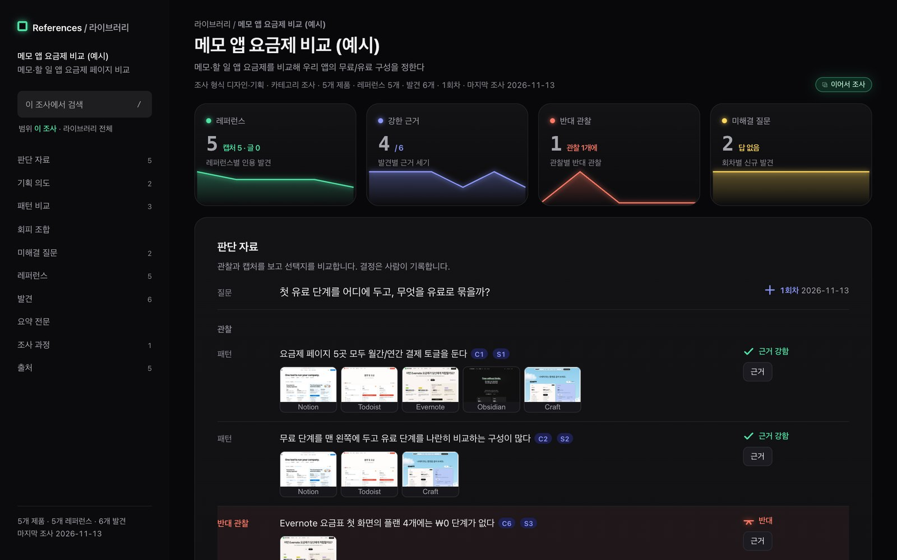
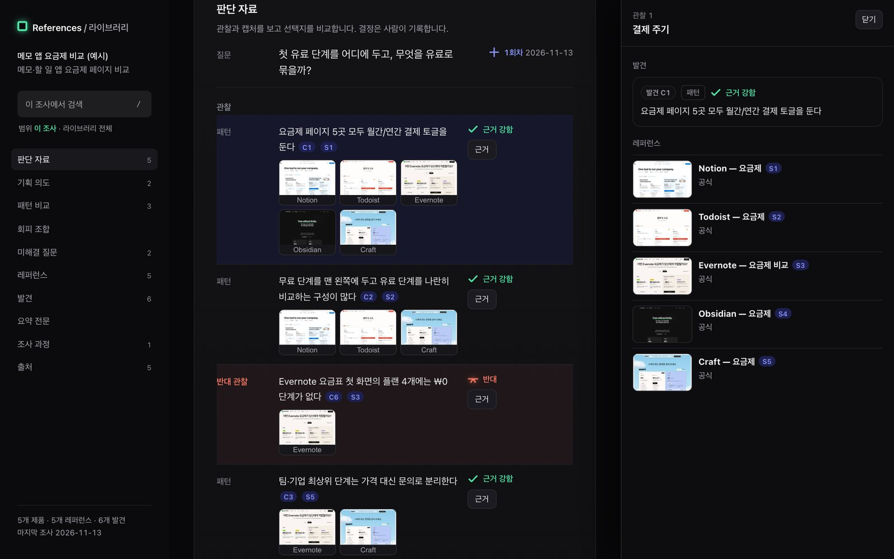
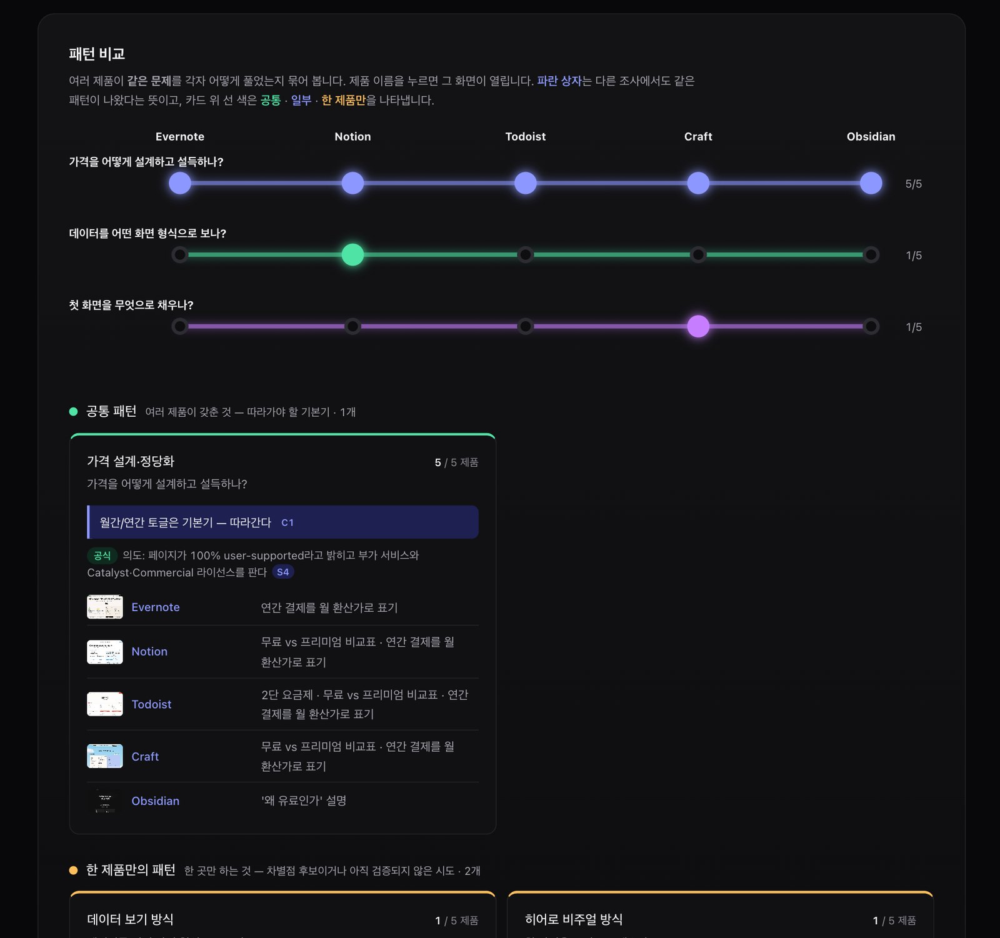
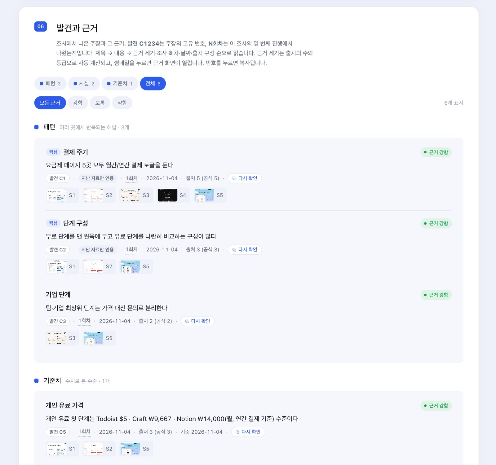
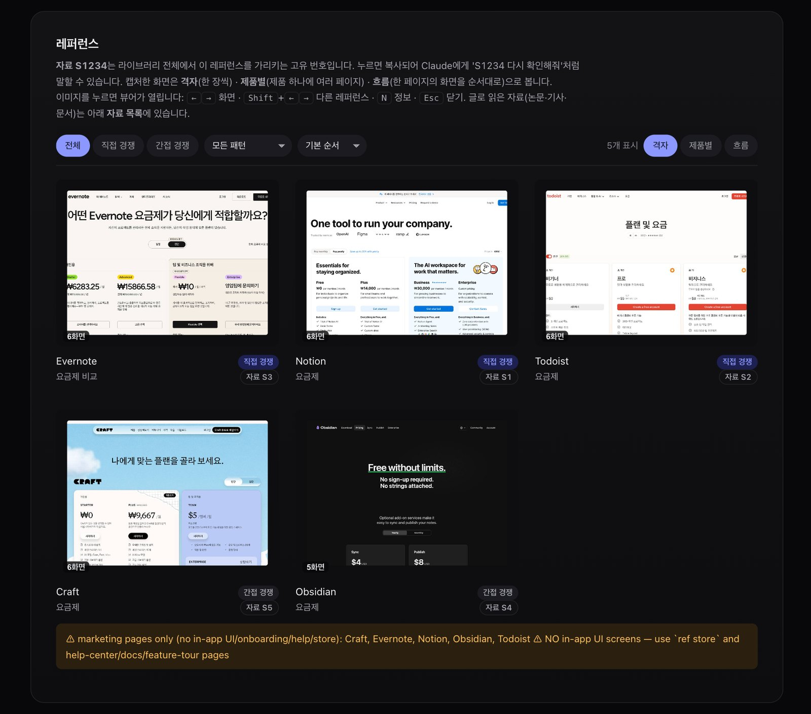
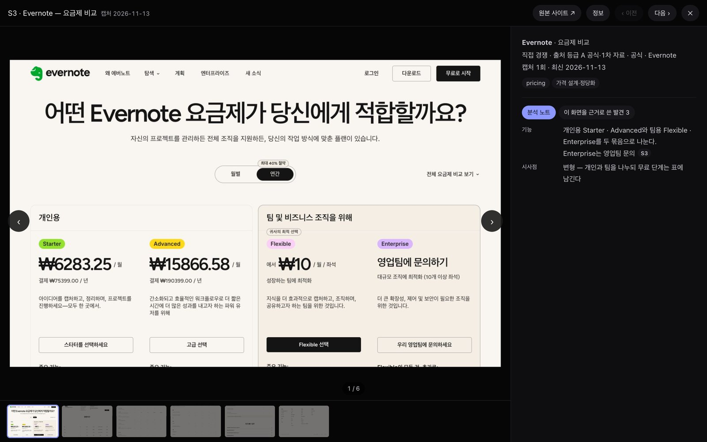
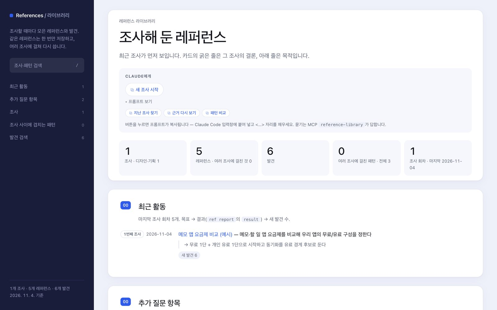

<p align="center"></p>

<h1 align="center">reference-research</h1>

<p align="center"><b>출처가 남는 레퍼런스 조사, Claude Code 안에서</b><br>
비슷한 서비스·경쟁 화면·강의를 찾아 실제 화면을 캡처하고, 발견마다 근거를 붙여 카테고리별 비교 보드로 정리합니다.</p>

<p align="center">


</p>

> **베타입니다.** 동작과 보드 구성이 아직 바뀔 수 있어요. 문제나 아이디어는 [피드백](#피드백--문제-보고)으로 보내 주세요.

---

## 왜
- **조사 전에 목적부터 좁힙니다**: 요청이 모호하면 질문으로 문제와 목표를 잡고, 개요를 확인받은 뒤 시작합니다. "~티 안 나게" 같은 회피 조건을 그대로 목표로 삼지 않습니다.
- **최신 자료부터 봅니다**: 최신 자료의 단서로 질의를 고치며 최대 3바퀴 찾고, 12개월이 지났거나 날짜를 모르는 자료는 지난 자료로 표시합니다.
- **조사 결과에 근거가 남습니다**: "다들 연간 결제를 할인해 준다" 같은 발견마다 어떤 화면에서 봤는지(S1, S2…)가 붙고, 출처 수와 등급으로 **근거 강함 · 보통 · 약함**을 자동으로 매깁니다.
- **실제 화면을 봅니다**: 페이지를 스크롤하며 화면 단위로 캡처하고, 전체 페이지도 이어 붙입니다. App Store 화면도 받아 옵니다.
- **한 번 모은 자료를 다시 씁니다**: 다른 조사에서 같은 사이트를 만나면 새로 모으지 않고 카테고리만 추가하고, 30일이 지났으면 다시 캡처해 **무엇이 바뀌었는지** 기록합니다.
- **결론이 맨 위에 옵니다**: 보드는 질문 · 답 · 제안 · 근거 3개 · 반대 근거를 첫 화면에 두고, 근거 노선 그림으로 어떤 발견과 화면에 기대는지 보여 줍니다. 원자료와 조사 과정은 아래로 내립니다.
- **왜 그렇게 만들었는지 따라갑니다**: 무엇이 보이는지에서 멈추지 않고 기획 의도를 공식 · 정황 · 추정으로 나눠 기록합니다.
- **다음 조사로 바로 이어집니다**: 보드와 홈의 버튼 하나로 "이어서 하기", "다시 확인", "새 조사 시작" 프롬프트가 복사됩니다. 붙여 넣으면 Claude가 그 자리에서 이어 갑니다.
- **같은 문제를 어떻게 풀었는지 나란히 봅니다**: 제품마다 다른 이름으로 붙은 태그를 공통 패턴으로 묶어 비교합니다.
- **커리큘럼 비교도 됩니다**: 강의들의 주제·시간·순서·빈틈을 비교해 교육 과정을 설계할 때 씁니다.

## 어떻게 동작하나
1. Claude에게 조사를 맡깁니다. 예: "가계부 앱 온보딩 레퍼런스 조사해줘"
2. Claude가 질문으로 목적을 좁히고 개요를 확인받습니다.
3. 최신 자료부터 넓게 모은 뒤(보통 12개 이상) 직접 경쟁 · 간접 경쟁 · 트렌드로 골라냅니다. 첫 바퀴가 끝나면 방향을 한 번 더 확인합니다.
4. 고른 페이지를 캡처하고, 화면을 보며 노트와 발견(근거 포함)을 기록합니다. 바퀴와 캡처 진행은 터미널에 표시됩니다.
5. 카테고리별 **보드**(HTML)를 만들고 라이브러리(`~/references`)에 쌓습니다. 다음 조사는 여기서 이어 갑니다.

## 둘러보기
아래 화면은 데모 조사 "메모·할 일 앱 요금제 페이지 비교"(5개 제품)로 만든 실제 보드와 라이브러리 홈입니다. 보드를 직접 눌러 보려면 [`docs/example/board.html`](docs/example/board.html)을 내려받아 브라우저로 여세요.

<p align="center"></p>
<p align="center"></p>

| 패턴 비교 — 패턴 노선과 제품별 해법 | 발견 — 근거 세기 자동 계산, 반대 출처 |
|---|---|
|  |  |
| **레퍼런스 — 격자 · 제품별 · 흐름 보기** | **화면 뷰어 — 화면 단위 · 전체 페이지 · 분석 노트** |
|  |  |

보드와 홈은 어두운 화면 한 가지입니다. 발광은 도형(스파크라인, 상태 점, 히트맵, 강조 선)에만 쓰고 글자에는 쓰지 않습니다.

**보드** (조사 하나)
- **머리**: 조사 제목, 목적, 조사 형식(분야) · 회차 · 마지막 조사. "이어서 조사" 프롬프트 복사
- **숫자 카드**: 레퍼런스 · 강한 근거 · 반대 근거 · 미해결 질문. 누르면 해당 구역으로
- **핵심 결론**: 질문 · 답 · 제안 · 근거 3개 · 반대 근거를 한 줄씩. 오른쪽 여백에 근거 세기, 반대 근거, 열람 미기록 표시. 줄에 마우스를 올리면 그 줄이 인용한 캡처가 밝아집니다
- **근거 노선**: 질문 → 답 → 근거 → 반대 근거의 개요 그림과, 고른 노드가 기대는 발견·자료의 상세 그림. 자료 노드를 누르면 캡처가 열립니다
- **기획 의도**: 왜 이렇게 만들었는지 공식 · 정황 · 추정으로 나눈 카드. 이름은 분야별로 다르고(전략적 의도, 설계 의도 등) 조사마다 바꿀 수 있습니다
- **패턴 비교**: 질문 하나가 노선 하나인 패턴 노선(제품마다 정거장)과 패턴 카드. 패턴마다 **결론 한 줄**
- **회피 조합 · 미해결 질문**: 맥락과 함께 적은 피할 조합, 답에 따라 결론이 달라질 질문과 그 의도
- **레퍼런스**: 캡처는 격자 · 제품별 · 흐름 보기(마우스를 올리면 화면이 넘어감), 글로 읽은 자료는 날짜와 신선도가 붙은 **자료 목록** 표
- **발견**: 제목 → 내용 → 근거 세기 · 조사 회차 · 날짜 · 출처 구성. 반대 출처와 열람 기록(열람 미기록 · 요약만 읽음)도 함께. "다시 확인"은 프롬프트 복사
- **요약 전문 · 조사 과정 · 출처**: 요약 원문, 개요 · 바퀴 기록 · 채널 · 신선도, 인용 자료 색인(A 공식·1차 자료 ~ D 미확인)
- **검색(`/`)**: 레퍼런스 · 발견 · 패턴을 한 번에 찾기

**라이브러리 홈** (`~/references/index.html`)

<p align="center"></p>

- **숫자 카드**: 최근 8주 조사 회차 · 신규 발견, 레퍼런스, 미해결 질문 — 스파크라인으로 흐름까지
- **조사 타임라인**: 조사마다 첫 회차부터 마지막 회차까지. 마우스를 따라가는 세로선이 그 주의 회차를 보여 줍니다
- **조사 목록**: 최근 조사순, **주제** 칩으로 걸러 보기, 줄마다 결론 한 줄 · 미해결 질문 · 진행 중
- **활동**: 12주 동안 조사한 날을 육각 칸으로(신규 발견이 많은 날일수록 밝은 녹색)
- **공유 레퍼런스**: 여러 조사가 함께 쓴 레퍼런스를 연결 그림과 목록으로
- **교차 패턴 · 최근 활동 · 미해결 질문 · 발견 검색**: 두 조사 이상에서 나온 해법, 마지막 회차 5개, 조사별 열린 질문, 라이브러리 발견 전체 검색
- **MCP 연결**: 조사가 아닌 다른 작업 중에도 Claude가 라이브러리를 검색해 근거로 씁니다("지난번 조사에서 한도 표시를 어떻게 했지?")

## 캡처 방식
| 방식 | 조건 | 비고 |
|---|---|---|
| 🟢 Aside | Aside가 설치되어 있음 | 내 브라우저 그대로 캡처(로그인된 페이지 포함) |
| 🟢 Chrome | Google Chrome · Chromium · Edge 중 하나 | 로그인 없이 새 창으로 캡처. 로그인 필요한 페이지는 로그인 화면이 찍힘 |
| 🟡 없음 | 둘 다 없음 | 화면 없이 글 자료(기사·문서)로만 조사 |

자동으로 고릅니다(Aside → Chrome → 없음). 바꾸려면 `REF_CAPTURE=chrome`처럼 지정하세요.

## 설치
**필요한 것**: Claude Code · Node.js 20 이상 · Python 3 + Pillow(`pip3 install pillow`) · Chrome 또는 Aside · git(권장)

1. Claude Code에서:
   ```
   /plugin marketplace add Fox-Yeom/reference-research
   /plugin install reference-research@reference-research-beta
   ```
2. Claude Code를 다시 시작하고 **"레퍼런스 조사 도구 상태 점검해줘"** 라고 말합니다.
   ```
   ✓ Node 22.x
   ✓ Python + Pillow 12.x
   ✓ capture: headless Chrome — Aside not found, so pages are captured without your logins
   ⚠ embeddings not installed — optional; text search still works
       → ref setup --embeddings   (~700 MB, one time)
   ⚠ library is not a git repo — no history to roll back to
       → ref setup --git
   ```
   ⚠ 항목은 안내된 명령으로 해결합니다. 처음 한 번 **`ref setup --git`** 을 권장해요(라이브러리 변경 이력 보관).
   - 처음 실행할 때 필요한 패키지(약 80 MB)를 받느라 잠시 걸립니다.

**선택 — 의미 검색**: `ref setup --embeddings`(약 700 MB, 한 번). 관련 레퍼런스 추천과 뜻으로 찾기가 켜집니다. 없어도 나머지는 모두 동작하고, 검색은 글자 일치로 합니다.

**업데이트**: `/plugin marketplace update reference-research-beta` → 새 버전이 있으면 갱신됩니다. 라이브러리는 그대로 남아요. 바뀐 점은 [CHANGELOG](CHANGELOG.md).

## 이렇게 말해 보세요
| 하고 싶은 것 | 예시 |
|---|---|
| 새 조사 | "가계부 앱 온보딩 레퍼런스 조사해줘" |
| 경쟁 분석 | "노션 대체 메모 앱들 요금제 비교해줘" |
| 커리큘럼 | "비전공 직장인 대상 AI 실무 강의들 비교해줘" |
| 이어서 조사 | "요금제 비교에 Bear랑 Apple 메모도 추가해줘" |
| 다시 확인 | "지난 조사 다시 캡처해서 바뀐 점 알려줘" / 보드의 발견 카드에서 "다시 확인" 버튼 |
| 추가 질문 이어서 | 홈 또는 보드의 "이어서 하기" 버튼 → 붙여 넣기 |
| 라이브러리 검색 | "지금까지 모은 것 중 온보딩 진행 표시 사례 찾아줘" |
| 보드 열기 | "요금제 비교 보드 열어줘" |

## 데이터와 개인정보
- 모든 자료는 **이 컴퓨터에만** 있습니다: `~/references/`(라이브러리: 캡처 이미지·노트·발견·보드), `~/.reference-research/`(도구 데이터·임베딩 모델)
- 플러그인이 밖으로 보내는 것은 없습니다. 인터넷은 조사 대상 페이지 열기, App Store 정보 받기, (선택) 임베딩 모델 받기에만 씁니다.
- 캡처는 **읽기 전용**입니다. 폼 제출 · 가입 · 결제 · 글쓰기 · 동의 버튼 클릭은 하지 않습니다.
- Chrome 캡처는 로그인 정보 없는 임시 프로필로 실행되고, 끝나면 지워집니다.
- 라이브러리에는 다른 사이트의 화면이 들어 있습니다. **공개 저장소에 올리지 마세요.** Claude도 요청 없이는 push하지 않습니다.

## 피드백 · 문제 보고
- 저장소 [Issues](https://github.com/Fox-Yeom/reference-research/issues) → New issue → **"베타 피드백"** 양식으로 남겨 주세요. 누구나 열 수 있습니다.
- 붙여 주시면 좋은 것: `ref doctor` 결과 · 무엇을 요청했고 → 무엇을 기대했고 → 무엇이 보였는지 · 보드 화면 캡처(문제 있는 부분)
- 회사 내부 자료를 조사했다면 캡처나 노트를 그대로 올리지 말고 가려 주세요.

## 알려진 문제
- Chrome 캡처는 로그인이 필요한 페이지, 봇 차단이 강한 사이트에서 실패하거나 로그인 화면이 찍힙니다.
- 쿠키 배너 · 채팅 위젯이 화면에 남는 경우가 있어요(자동으로 가리지만 완벽하지 않음).
- 보드의 일부 안내 문구(커버리지 경고 등)는 아직 영어입니다.
- macOS에서 주로 시험했습니다. Windows · Linux는 Chrome 경로를 `REF_CHROME=<경로>`로 지정해야 할 수 있어요.

## 지우기
1. Claude Code에서 `/plugin uninstall reference-research@reference-research-beta`
2. (마켓플레이스까지) `/plugin marketplace remove reference-research-beta`
3. (도구 데이터까지) `~/.reference-research` 삭제
4. (모은 자료까지) `~/references` 삭제 — **되돌릴 수 없으니 필요한 보드는 먼저 따로 보관하세요**

## 고지
- 라이선스: [MIT](LICENSE).
- 데모 화면의 캡처 이미지(Notion · Todoist · Evernote · Obsidian · Craft 요금제 페이지)는 기능 설명용 예시이며, 각 권리는 해당 회사에 있습니다.
