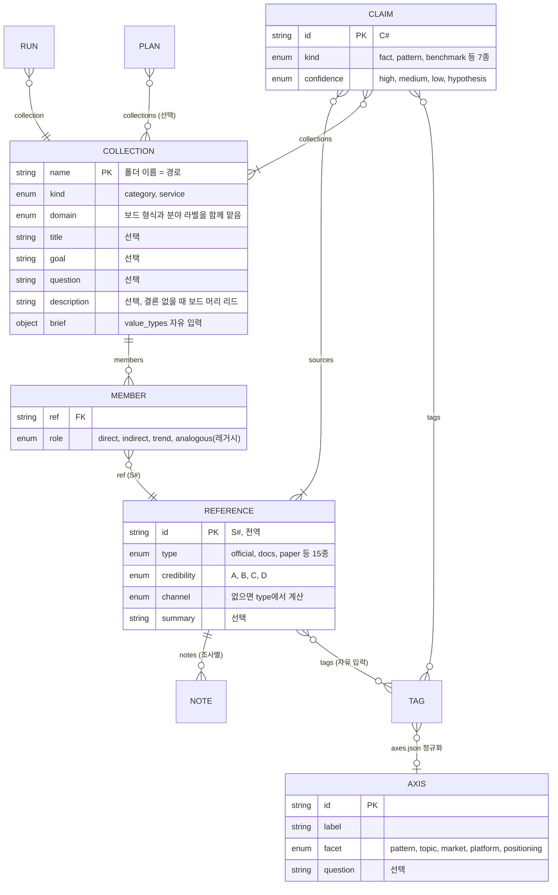
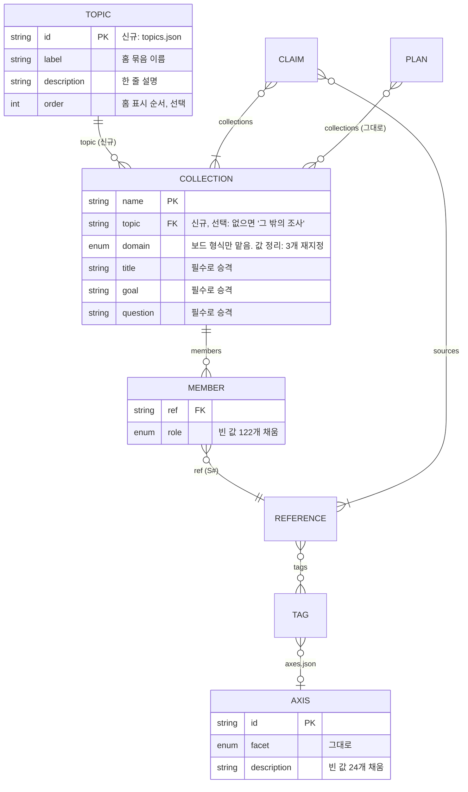
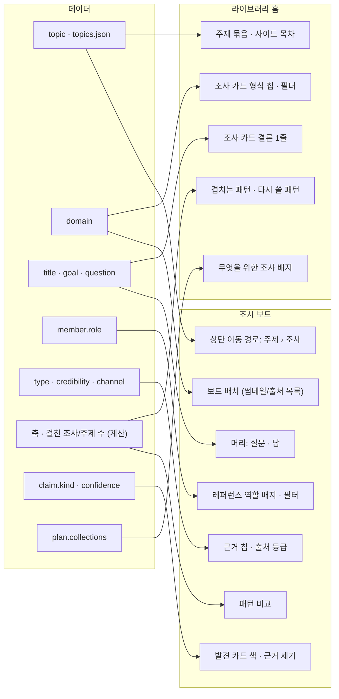
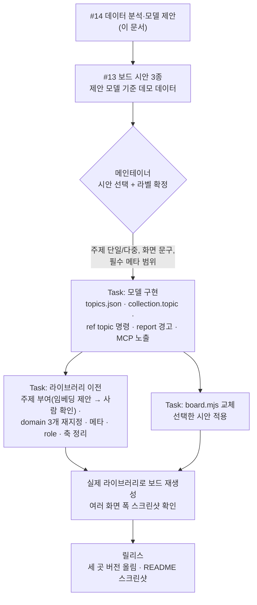
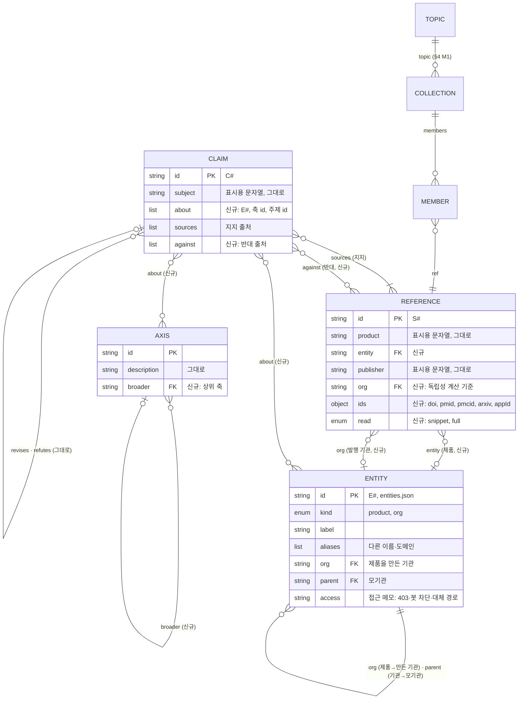
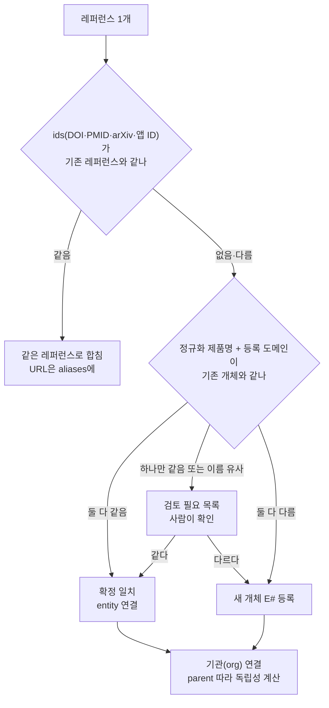
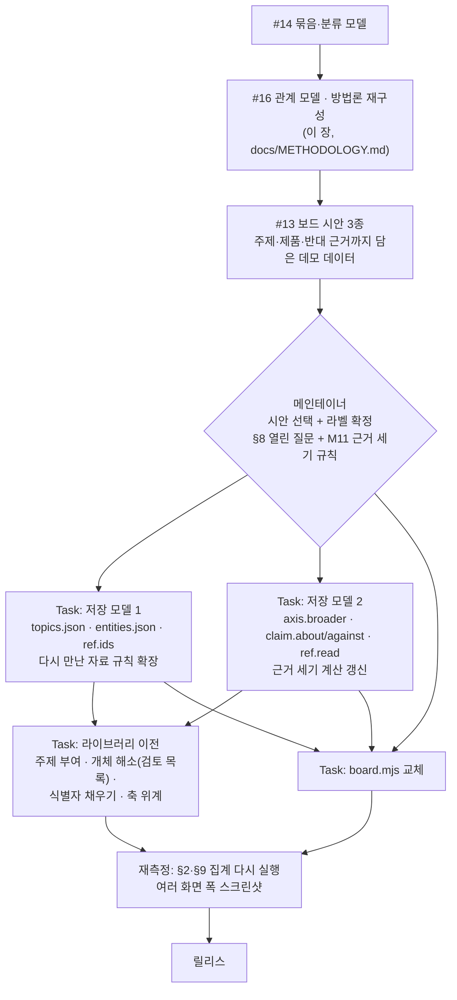

# 라이브러리 라벨·카테고리 데이터 모델 (분석 · 2026-11-13)

Issue #14. 다음 단계: 보드 디자인 시안(#13)이 이 문서의 제안 모델을 쓴다.
상태: 분석과 제안. 코드와 라이브러리 데이터는 바꾸지 않았다.

## 0. 목적

보드 디자인을 바꿔 시인성을 높이려 한다. 보는 사람이 화면에서 가장 먼저 쓰는 것은 묶음, 분류, 라벨이다. 색과 글꼴은 그다음이다. 그런데 지금 데이터에는 그 묶음이 없거나, 라벨이 비어 있거나, 한 필드가 두 가지 일을 한다. 이 상태로 시안을 만들면 시안이 지금의 빈칸과 잘못된 분류를 그대로 꾸미게 된다.

이 문서는 세 가지를 정한다.

1. 지금 데이터가 어떻게 생겼고 무엇이 비어 있는가 (§1–§3)
2. 무엇을 어떤 방식으로 모델링하고, 왜 그 방식인가 (§4–§5)
3. 시안 → 라벨 확정 → 구현·이전을 어떤 순서로 하는가 (§6–§7)

원칙: 새 필드는 시인성 문제를 직접 푸는 것만 더한다. 이미 있는 필드로 풀 수 있으면 표시 규칙이나 값 정리로 푼다.

## 1. 현재 데이터 모델

형식의 정본은 `scripts/store.mjs` 머리 주석과 `skills/reference-research/SKILL.md`의 "Model"이다. 아래는 라벨·카테고리에 관계된 부분만 그린 것이다.

라벨의 층은 넷이다.

| 층 | 무엇에 붙나 | 필드 | 정해진 값인가 |
|---|---|---|---|
| 조사 | 컬렉션 | `kind`, `domain`, `brief.value_types` | `kind`·`domain`은 정해진 값, `value_types`는 자유 입력 |
| 조사 안의 자리 | 멤버 | `role` | 정해진 값 |
| 자료 | 레퍼런스 | `type`, `credibility`, `channel`, `tags` | `tags`만 자유 입력 |
| 내용 | 발견, 축 | `kind`, `confidence`, 축 `facet` | 정해진 값. 축 자체는 태그를 묶은 사전 |

조사보다 위의 층은 없다. 홈은 조사를 `domain` 칩으로만 걸러 낸다.

## 2. 실측

집계 기준일: 2026-11-13.
대상: 메인테이너의 실제 라이브러리. 읽기만 했다.
공개 저장소이므로 조사 이름, 제품명, 프로젝트명은 적지 않는다. 주제는 A–D 같은 익명 이름으로 적는다.

집계 방법:
- `refs.jsonl`, `claims.jsonl`, `runs.jsonl`은 같은 `id`의 마지막 줄을 현재 값으로 본다. CLI와 같은 upsert 규칙이다.
- 컬렉션은 `*/collection.json` 37개를 읽었다.
- 축은 `axes.json`을 읽었다. 레퍼런스 태그를 축의 `tags`로 바꾼 뒤, 그 레퍼런스가 속한 컬렉션 수를 셌다. "쓰이는 축"은 멤버 레퍼런스 중 하나라도 그 축의 태그를 가진 축이다.
- 멤버는 컬렉션의 `members` 항목 하나다. 같은 레퍼런스가 두 조사에 있으면 멤버 2개로 센다(`role` 집계 단위). 멤버 수 비율은 컬렉션별 멤버 수 합 대비다.
- 레퍼런스 필드(`summary`, `channel`, 메모 `fields`)는 값이 비어 있지 않은 레퍼런스 수다. `channel` 직접 입력은 저장된 값만 센다.
- 태그는 모든 레퍼런스의 `tags`를 합친 종류 수와 사용 횟수다. "축에 연결되지 않은 태그"는 어떤 축의 `tags`에도 없는 태그다. 발견 태그도 같은 방식이다.
- 숨은 주제 묶음(§2.1)은 이름에 공통 단어가 있고 목표가 같은 대상을 다루는 컬렉션을 손으로 묶었다.

### 2.1 조사(컬렉션)

| 항목 | 값 |
|---|---|
| 컬렉션 | 37개, 위계 없음. `kind`: category 35, service 2 |
| 멤버 수 | 12–273개. 상위 3개가 전체 멤버의 38% |
| `domain` | design 16 · research 13 · dev 5 · strategy 2 · curriculum 1. `voice`·`travel`은 0 |
| `domain`이 성격과 맞지 않음 | 3개: 연구 조사가 아닌데 research로 지정됨(조사 이름은 공개하지 않음). 회차(`runs.jsonl`)의 `domain`과 컬렉션의 `domain`이 다른 경우도 3건 |
| 숨은 주제 묶음 | 주제 A 7개(dev 1 · research 6), 주제 B 3개(design 1 · research 2), 주제 C 3개(design), 주제 D 2개(research). 15개 컬렉션이 4개 주제에 몰려 있다. 이 묶음을 표현하는 필드는 없다 |
| 기획(`plans/`) 연결 | 기획 2개가 컬렉션 3개만 가리킨다 |
| `title` | 27/37 |
| `goal`·`audience`·`question`·`highlights` | 20/37 |
| `description` | 34/37 |
| `brief` | 7/37. `value_types` 값은 7종(정해진 6종 밖의 값 3종 포함) |
| `reader` | 7/37 |

### 2.2 레퍼런스와 멤버

| 항목 | 값 |
|---|---|
| 레퍼런스 | 1,979개. 어느 조사에도 속하지 않은 것 8개 |
| 속한 조사 수 | 1개 1,849(93%) · 2개 100 · 3개 9 · 4개 13 |
| `role` | direct 1,049 · indirect 897 · trend 60 · 없음 122 |
| `type` | paper 426 · official 374 · docs 296 · press 278 · blog 160 · capture 123 · 그 밖 322 |
| `credibility` | A 888 · B 562 · C 459 · D 70 |
| `channel` 직접 입력 | 64개(3%). 나머지는 `type`에서 계산하므로 `other` 60개를 빼면 모두 값이 있다 |
| `summary` | 588개(30%) |
| 태그 | 774종 중 352종(45%)은 한 번만 쓰임. 축에 연결되지 않은 태그는 29종(사용 115회 / 전체 2,474회) |
| 조사별 메모 | 1,428개. `fields`가 있는 것 169개 |

### 2.3 축과 발견

| 항목 | 값 |
|---|---|
| 축 | 290개. `facet`: pattern 256 · topic 19 · positioning 7 · market 6 · platform 2 |
| 쓰이는 축 | 268개. 쓰이지 않는 축 22개 |
| 축이 걸친 조사 수 | 1개 183(68%) · 2개 54 · 3개 8 · 4개 13 · 5개 이상 10 |
| `domain`이 다른 조사를 잇는 축 | 21개 |
| 설명·질문 | 설명 없는 축 24개, 질문 있는 축 36개 |
| 발견 | 834개. 조사 1개에만 속한 것 830개 |
| 발견 태그 | 644종 중 591종이 축에 연결됨. 태그 없는 발견 64개 |

## 3. 문제

| # | 문제 | 근거(§2) | 화면에 생기는 일 |
|---|---|---|---|
| P1 | **조사보다 위의 묶음이 없다** | 37개 평면. 15개가 숨은 주제 4개에 몰림 | 홈이 긴 카드 목록 하나가 된다. 같은 주제의 조사가 흩어진다 |
| P2 | **`domain`이 두 가지 일을 한다** | 보드 형식(`SOURCE_LED`, `COVERAGE`, 단위 이름, 머리 제목)과 분야 라벨을 함께 맡는다. 3개는 분야가 잘못 지정된 것으로 보인다(원인은 확인하지 못함) | 분야 필터가 믿을 만하지 않다. 주제 B는 한 주제가 두 분야로 갈라진다 |
| P3 | **분야 분류가 둘이다** | `domain`(정해진 값)과 `brief.value_types`(자유 입력, 7/37에만 있음) | 둘 중 무엇을 라벨로 보일지 정할 수 없다 |
| P4 | **축이 많고 대부분 한 조사 안에서만 쓰인다** | 290개 중 183개가 조사 1개에서만 쓰임. `facet`의 88%가 pattern이어서 facet으로는 나뉘지 않는다 | 홈의 "겹치는 패턴"에 모든 축을 펴면 다시 긴 표가 된다 |
| P5 | **머리글에 쓸 메타가 비어 있다** | `title` 27/37, `goal`·`question` 20/37 | 보드 머리와 홈 카드의 1줄 요약이 빈칸이 되거나 폴더 이름이 대신 나온다 |
| P6 | **멤버 역할이 비어 있다** | `role` 없음 122 | 역할 필터를 쓰면 일부 레퍼런스가 사라진다 |

다음은 문제가 **아니다**.
- `channel`: 직접 입력은 3%지만 `type`에서 계산하므로 실제로 빈 것은 `other` 60개다.
- 태그 잡음: 한 번만 쓰인 태그가 45%지만 축이 흡수한다. 연결되지 않은 태그는 29종뿐이다. 화면에는 태그 대신 축 이름을 보이면 된다.
- 레퍼런스 전역 모델: 레퍼런스를 여러 조사가 함께 쓰는 구조는 그대로 둔다. 같은 레퍼런스가 여러 조사에 들어간 경우는 122개(6%)로 적지만, 다시 만나면 재사용한다는 규칙의 바탕이다.

## 4. 제안 모델

| # | 바꾸는 것 | 방식 | 푸는 문제 |
|---|---|---|---|
| M1 | **주제(topic) 층 신설** | `<LIB>/topics.json`에 주제 목록을 두고 `collection.topic`에 그 `id`를 적는다. 한 조사에 주제 하나. 비어 있어도 된다 | P1 |
| M2 | **`domain`은 보드 형식만 맡는다** | 값 목록은 그대로 둔다. 성격과 맞지 않는 3개를 `travel` 또는 `strategy`로 재지정한다(대상은 이전 작업에서 확인). 화면 이름은 "조사 형식"으로 바꾼다 | P2 |
| M3 | **분야 라벨은 주제와 형식 둘로 끝낸다** | `brief.value_types`는 개요 표 안에만 두고, 내비게이션 라벨로 쓰지 않는다 | P3 |
| M4 | **축은 모델을 바꾸지 않고 표시 규칙으로 나눈다** | 걸친 조사 수와 주제 수는 계산해서 얻는다. 보드: 그 조사의 모든 축. 홈: 조사 2개 이상에 걸친 축(85개). "다시 쓸 수 있는 패턴": 주제 2개 이상에 걸친 축 | P4 |
| M5 | **머리글 메타를 필수로 승격** | `title`·`goal`·`question`이 없으면 `ref report`가 경고한다. 기존 조사는 이전 작업에서 채운다 | P5 |
| M6 | **빈 값 정리** | `role` 없는 멤버 122개와 설명 없는 축 24개를 채운다. 쓰이지 않는 축 22개는 지운다 | P6, P4 |

## 5. 모델링 방식과 이유

### 5.1 주제 층(M1): 검토한 대안

| 대안 | 방식 | 판단 |
|---|---|---|
| A. 이름 접두어 규칙 | 같은 주제 조사의 이름 앞을 맞춘다 | **기각.** 이름이 곧 폴더 경로이고 보드 링크다. 기존 37개 이름을 바꾸면 링크와 다른 저장소의 참조가 깨진다. 이름만으로는 라벨과 설명을 둘 곳도 없다 |
| B. 컬렉션 자유 태그(다대다) | 조사에 태그를 여러 개 단다 | **기각.** 한 조사가 홈의 여러 묶음에 반복된다. 자유 입력 태그는 이미 45%가 한 번만 쓰이고 있어, 같은 일이 되풀이된다 |
| C. 기획(`plans/`) 재사용 | 기획이 가리키는 조사를 묶음으로 본다 | **기각.** 기획은 제품 기획 항목과 발견의 위치를 담는다. 기획 없는 개인 조사를 표현할 수 없고, 지금은 37개 중 3개만 가리킨다 |
| D. 임베딩 자동 군집 | `ref categories`의 조사 벡터로 자동으로 묶는다 | **표시 라벨로는 기각.** 다시 계산할 때마다 묶음이 바뀌고 이름이 없다. 대신 이전 작업에서 주제를 제안하는 재료로 쓴다 |
| **E. 등록부 + 참조(채택)** | `topics.json`에 주제를 등록하고, 조사는 `id` 하나를 가리킨다 | **채택.** `axes.json`(축 등록부 + 태그 참조)과 같은 방식이라 코드와 사람 모두에게 익숙하다. 라벨, 설명, 순서를 한곳에서 고친다. 조사 이름과 경로는 그대로 둔다 |

주제를 **하나만** 두는 이유:
- 홈에서 조사가 한 자리에만 나온다.
- 여러 조사를 잇는 일은 이미 레퍼런스(전역)와 축(계산)이 맡는다. 주제까지 다대다로 만들면 같은 일을 셋이 맡는다.
- 주제 B처럼 한 주제 안에 형식이 다른 조사가 섞여도 문제가 없다. 주제와 형식은 서로 독립된 두 축이다.

### 5.2 `domain`을 형식으로 좁히는 이유(M2, M3)

- `domain`은 보드가 어떻게 그려지는지를 정한다. 출처 중심 목록인지 화면 썸네일인지(`SOURCE_LED`), 어떤 화면 종류를 갖춰야 하는지(`COVERAGE`), 단위 이름, 머리 제목이 여기서 갈린다. 이 역할을 다른 필드로 옮기면 기존 보드가 모두 바뀐다.
- 그래서 `domain`에는 형식만 맡기고, "무엇에 관한 조사인가"는 주제가 맡는다. 잘못된 3개는 값만 고치면 된다.
- `value_types`는 조사를 시작할 때 묻는 질문의 답이다. 정해진 값 밖의 답이 나올 수 있어야 하므로 정해진 값으로 굳히지 않는다.

### 5.3 축에 필드를 더하지 않는 이유(M4)

- 축이 많은 것은 축이 태그 정규화 사전이기 때문이다. 문제는 화면에서 모든 축을 같은 무게로 펴는 것이다.
- 걸친 조사 수와 주제 수는 이미 있는 데이터로 계산된다. 저장하면 조사가 늘 때마다 낡는다.
- `facet`을 다시 나누면 쓰이는 축 268개를 사람이 다시 분류해야 한다. 그 비용에 비해 시인성 효과가 작다.

### 5.4 필수로 승격하는 범위(M5)

필수로 올리는 것은 보드 머리와 홈 카드가 실제로 쓰는 세 필드뿐이다. `description`은 결론이 없을 때 보드 머리 리드로 쓰이지만, 34/37에 이미 있고 결론이 생기면 쓰이지 않으므로 선택으로 둔다. `audience`, `highlights`, `brief` 같은 나머지 필드도 선택으로 둔다. 조사 하나를 시작하는 비용을 늘리지 않기 위해서다.

## 6. 라벨과 화면 요소 연결 (#13 시안이 쓰는 것)

| 필드 | 시안의 화면 요소 | 비어 있을 때 시안이 보일 것 |
|---|---|---|
| `topic` → `topics.json.label` | 홈 1단계 묶음과 사이드 목차, 보드 상단 이동 경로 | "그 밖의 조사" 묶음 |
| `topics.json.description` | 홈 주제 묶음 제목 아래 한 줄 | 줄을 그리지 않는다 |
| `topics.json.order` | 홈 주제 묶음과 사이드 목차의 순서 | 최근 조사순 |
| `domain` | 홈 조사 카드의 형식 칩과 필터, 보드 배치 | 형식은 항상 있다(기본 `design`) |
| `title`·`goal`·`question` | 보드 머리(질문 · 답), 홈 카드 결론 1줄 | 경고 배지. 폴더 이름을 제목처럼 보이지 않는다 |
| `member.role` | 레퍼런스 카드의 역할 배지와 역할 필터 | "역할 미정" 배지. 필터에서 숨기지 않는다 |
| `type`·`credibility`·`channel` | 근거 칩, 출처 등급, 조사 과정의 채널 표 | `channel`은 계산값을 쓴다 |
| 축 + 걸친 조사/주제 수 | 홈 "겹치는 패턴"(조사 2개 이상), "다시 쓸 수 있는 패턴"(주제 2개 이상), 보드 패턴 비교 | 해당 영역을 그리지 않는다. 빈 표 틀을 두지 않는다 |
| `axis.facet` | 보드·홈에서 패턴(`pattern`)과 제품 속성(그 밖의 facet)을 나눠 보이는 기준(지금과 같음) | 항상 있다 |
| `axis.description`·`question` | 패턴 비교의 축 설명 한 줄, 비교 제목의 질문 | 설명 줄을 그리지 않고 축 이름만 보인다 |
| `claim.kind`·`confidence` | 발견 카드 색과 근거 세기 | 항상 있다 |
| `plan.collections` | 홈 카드의 "무엇을 위한 조사" 배지 | 배지를 그리지 않는다 |

#13 시안의 데모 데이터(`dev/demo.sh`의 중립 주제)에는 주제 2개 이상과 "그 밖의 조사" 1개, 형식이 다른 조사가 섞인 주제 1개, 메타가 빈 조사 1개를 넣는다. 그래야 위의 빈 상태까지 시안에서 볼 수 있다.

## 7. 향후 계획

관계 모델을 더한 갱신본은 §13에 있다. 아래는 #14 시점의 계획이다.

| 단계 | 하는 일 | 바뀌는 곳 | 끝났다고 보는 기준 |
|---|---|---|---|
| #13 시안 | 이 모델로 홈과 보드 시안 3종 | `docs/` | 시안 선택 |
| 라벨 확정 | §8의 열린 질문을 시안을 보고 결정 | 이 문서 갱신 | 열린 질문 0 |
| 모델 구현 | `topics.json` 읽기·쓰기, `collection.topic`, 주제 지정 명령, 필수 메타 경고, MCP `list_collections`에 주제 노출, `seed/` 기본값 | `scripts/` | `dev/test.sh` 통과, 주제 없는 기존 라이브러리도 그대로 동작 |
| 라이브러리 이전 | 주제 부여, `domain` 재지정, 빈 메타·`role`·축 설명 채우기, 안 쓰는 축 정리 | 실제 라이브러리(저장소 밖) | §2 집계를 다시 돌려 P1–P6이 해소됨 |
| 보드 교체 | 선택한 시안을 `board.mjs`에 적용 | `scripts/board.mjs` | 여러 화면 폭 스크린샷, 메인테이너 확인 |
| 릴리스 | `docs/RELEASE.md` 절차 | 매니페스트 3곳, README | 설치된 플러그인이 갱신됨 |

호환성: `topic`은 선택 필드다. 주제가 없는 라이브러리(테스터의 라이브러리 포함)는 모든 조사가 "그 밖의 조사"에 들어가고 나머지는 지금처럼 동작한다. 그래서 모델 구현과 이전을 나눠 배포할 수 있다.

## 8. 열린 질문 (#13 시안을 보고 정함)

1. 주제는 하나만 둘 것인가? 시안에서 한 조사가 두 주제에 걸쳐야 하는 경우가 보이면 다시 검토한다.
2. 개인 조사와 업무 조사를 주제보다 위에서 한 번 더 나눌 것인가? 지금 제안은 나누지 않는다. 주제만으로 홈이 정리되는지 시안으로 확인한다.
3. `domain`의 화면 이름을 "조사 형식"으로 할 것인가, 칩에서 아예 숨길 것인가?
4. 멤버 수가 270개를 넘는 큰 조사 3개는 주제 안에서 조사를 나눌 것인가, 보드 안의 필터로 충분한가?

---

# 관계 모델 (Issue #16 · 2026-11-13)

§1–§8은 묶음(주제)과 분류(형식) 모델이다. 이 장은 레퍼런스, 제품, 발행처, 발견 사이의 **관계**에 이름을 붙이는 방식을 다룬다. 기존 데이터를 초기화하지 않고, 지금 구조에 필드와 등록부를 더하는 것을 전제로 한다. 캡처는 그 시점의 페이지 상태라 다시 얻을 수 없고, 다른 저장소가 이 라이브러리를 참조하기 때문이다.

## 9. 관계 실측

집계 기준일과 방법은 §2와 같다. 추가 정의:
- "제품 문자열"은 레퍼런스 `product` 값을 앞뒤 공백을 지우고 소문자로 바꾼 것이다. 개체 해소를 하지 않은 값이므로 실제 제품 수는 이보다 적다.
- "발행처 문자열"은 `publisher` 값을 소문자로 바꾼 것이다.
- "논문 호스트"는 `type: paper`인 레퍼런스 URL의 호스트(`www.` 제거)다.

| 항목 | 값 | 뜻 |
|---|---|---|
| 그래프 규모 | 노드 3,140(레퍼런스 1,979 · 발견 834 · 축 290 · 조사 37) · 주요 간선 7,022(멤버 2,128 · 발견→출처 2,420 · 태그 사용 2,474) | 빅데이터 규모가 아니다. 파일 전체를 읽어도 1초 안팎이다 |
| 제품 문자열 | 1,411종. 그중 223종이 레퍼런스 2개 이상에 나옴(레퍼런스 791개, 40%) | 같은 제품의 페이지·시점을 잇는 키가 문자열뿐이다 |
| 발행처 문자열 | 1,126종 / 레퍼런스 1,979 | 근거 세기의 "독립 발행처" 계산이 문자열 일치에 기댄다 |
| 논문 호스트 | 논문 426개 중 arXiv 97, NCBI 계열 3개 호스트(pubmed · pmc · www.ncbi) 112 | 같은 논문이 호스트·경로를 달리해 들어올 수 있다. 지금 정규화 라벨 중복은 0인데, 사람이 적재 전에 손으로 걸러서다(교훈 2026-10-15, 2026-10-20) |
| 발견 주어(`subject`) | 834개 발견에 632종. 2번 이상 쓰인 주어는 29종 | 주어가 자유 입력이라 "이 제품에 대한 발견"을 모을 수 없다 |
| 발견 사이 관계 | 관계 필드가 있는 발견 48개(`revises` 25 · `refutes` 2 · `replacedBy` 27, 한 발견에 둘 이상 있을 수 있음) · 확인 이벤트 15 | 정정은 기록되지만 지지·반박 관계는 거의 없다 |
| 출처별 입장 | 필드 없음. `sources`는 모두 지지로 읽힌다. 반대는 반박 발견(`refutes`, 834개 중 2개)이나 기획 위치(`contradicts`)로만 표현된다 | 한 발견 안의 반대 근거를 보일 수 없다 |
| 열람 수준 | 필드 없음. 대신 읽었다는 기록(스냅숏·`summary`)이 없는 출처를 셌다: 1,035개. 유효 발견 807개 중 268개가 이런 출처만 인용하고, 그중 166개가 근거 세기 "강함"이다 | 기록이 없다고 읽지 않은 것은 아니지만, 읽었는지 확인할 방법이 없다. 검색 요약만 보고 등록한 출처를 인용한 사례가 기록됨(교훈 2026-10-30) |

## 10. 방법론 조사와 대입

| 방법론 | 출처 | 핵심 | 우리 데이터에 대입 | 판단 |
|---|---|---|---|---|
| SKOS | [W3C SKOS Reference (2009 권고안)](https://www.w3.org/TR/skos-reference/) | 개념 체계: `prefLabel`/`altLabel`, 위계 `broader`(비이행), 연관 `related` | `axes.json`이 이미 거의 SKOS다(`label` = prefLabel, `tags` = altLabel). 위계가 없어 pattern 축 256개가 평면이다 | **채택(일부):** `axis.broader`만 더한다(M9). `related`는 공동 출현으로 계산하고 저장하지 않는다 |
| 패싯 분석 | [ISKO 백과 · Facet analysis](https://isko.org/cyclo/facet_analysis) (Ranganathan 1937 이래) | 한 기준으로 나눈 서로 배타적인 패싯 | 주제 · 형식 · 역할 · 자료 유형을 독립된 패싯으로 둔다 | **채택(이미 반영):** §4의 M1–M3와 같다. 새 필드 없음 |
| IFLA LRM (저작·표현·구현·개별) | [ISKO 백과 · LRM](https://isko.org/cyclo/lrm), [Wikipedia 요약](https://en.wikipedia.org/wiki/IFLA_Library_Reference_Model) | 같은 저작이 여러 판·형식으로 나온다는 4층 모델 | 같은 논문의 초록·전문·PDF·저장소 URL | **4층은 기각, 식별 키만 채택(M8):** 4층을 다 쓰면 서지 목록을 만들게 된다. 필요한 것은 "같은 저작이면 같은 레퍼런스" 하나다 |
| 개체 해소(record linkage) | [Fellegi & Sunter 1969, JASA 64(328)](https://doi.org/10.2307/2286061) | 비교 벡터와 두 임계값으로 일치 · 검토 필요 · 불일치 3구간 판정 | 제품 문자열 1,411종, 발행처 문자열 1,126종 | **채택(판정 방식만, M7):** 확률 모델은 규모에 비해 무겁다. 규칙으로 3구간을 나누고 "검토 필요"만 사람이 확인한다(`ref axes suggest`와 같은 방식) |
| 형식 있는 관계 그래프(property graph) | [ISO/IEC 39075:2024 GQL](https://webstore.iec.ch/publication/94107) | 노드와 간선에 유형과 속성을 둔다 | 레퍼런스→제품, 제품→기관, 발견→주어, 발견→출처(입장) | **모델 개념은 채택, 그래프 DB는 기각:** 간선은 JSONL 필드(외래 키)로 저장하고 보고서·MCP가 메모리에서 잇는다. 그래프 DB를 쓰면 설치가 무거워지고 git으로 변경을 비교할 수 없다. 3천 노드에는 이득이 없다 |
| Wikibase 진술 모델 | [Wikibase/DataModel](https://www.mediawiki.org/wiki/Wikibase/DataModel) | 진술 = 주어 + 주장 + 한정자(시점 등) + 참조 + 등급(우선·보통·폐기) | 발견이 이미 비슷하다: `subject` · `text` · `asOf`·`scope`(한정자) · `sources`(참조) · `status` active/superseded/refuted(등급) | **채택(주어 연결만, M10):** 빠진 것은 주어가 개체를 가리키는 것뿐이다 |
| Micropublications | [Clark, Ciccarese, Goble 2014, J Biomed Semantics 5:28](https://doi.org/10.1186/2041-1480-5-28) | 주장 + 지지·반박 근거 + 해석을 한 단위로 | 출처별 입장 없음 | **채택(입장만, M11):** `against`(반대 출처) 목록을 더한다. 해석·논증 층은 메모(`note`)가 이미 맡는다 |
| W3C PROV-O | [PROV-O (2013 권고안)](https://www.w3.org/TR/prov-o/) | Entity · Activity · Agent, `wasGeneratedBy`·`wasDerivedFrom` | 레퍼런스·스냅숏 = Entity, 회차 = Activity, 발견 `run` = 생성 활동, `revises` = 파생 | **대응표만 남기고 필드는 더하지 않음:** 이미 같은 구조다. Agent(어느 서브에이전트가 찾았나)는 기록 가치가 낮다 |
| ClaimReview | [Google 팩트체크 구조화 데이터](https://developers.google.com/search/docs/appearance/structured-data/factcheck) | 웹에 게시하는 사실 확인 표기 | 보드는 로컬 문서다 | **기각:** 게시용 표기라 목적이 다르다 |
| GraphRAG(그래프 + 군집 요약) | [Edge et al. 2024, arXiv:2404.16130](https://arxiv.org/abs/2404.16130) | LLM으로 개체·관계를 뽑고 Leiden 군집마다 요약해 말뭉치 전체 질문에 답 | "라이브러리 전체에서 무엇을 알았나" 같은 질문 | **전체 파이프라인은 기각, 생각만 채택:** 군집 요약의 역할은 주제(§4 M1)의 요약과 조사 `SUMMARY`가 맡는다. LLM 추출 비용과 군집 의존성이 3천 노드 규모에 비해 크다. 주제 제안은 이미 있는 임베딩(`ref categories`)으로 한다 |

규모 기준(빅데이터 관점): 지금 구조는 파일 전체를 읽어서 처리한다. 레퍼런스가 약 10만 개를 넘거나 보고서 생성이 눈에 띄게 느려지면, 그때 파생 색인(`.graph/`, `.vectors/`처럼 git 제외)을 둔다. 정본을 DB로 옮기는 것은 그다음 단계로 미룬다.

## 11. 제안 관계 모델

| # | 바꾸는 것 | 방식 | 푸는 문제(§9) | 채택한 방법론 |
|---|---|---|---|---|
| M7 | **개체 등록부** `entities.json` | 제품과 기관을 `E#`로 등록한다. 레퍼런스에 `entity`(제품)와 `org`(발행 기관)를 단다. 문자열 `product`·`publisher`는 표시용으로 남긴다. 기관에는 접근 메모(`access`)를 둔다 | 제품 문자열 1,411종 / 다중 223종, 발행처 문자열 1,126종, 같은 회사의 여러 브랜드를 독립 발행처로 세는 문제(교훈 2026-10-15) | 개체 해소(3구간 판정), property graph |
| M8 | **저작물 식별자** `ref.ids` | DOI·PMID·PMCID·arXiv·앱 ID를 저장한다. 같은 식별자면 같은 레퍼런스로 보고 URL은 `aliases`에 더한다. 다시 만나면 재사용한다는 규칙의 키를 URL에서 식별자까지 넓힌다 | 논문 URL이 호스트별로 갈림(arXiv 97, NCBI 112). 지금은 손으로 걸러 냄 | LRM(식별 키만) |
| M9 | **축 위계** `axis.broader` | 축 하나에 상위 축 하나. 상위 축도 같은 `axes.json`에 둔다 | pattern 축 256개가 평면. 홈의 "겹치는 패턴"을 묶을 수 없다 | SKOS |
| M10 | **발견 주어 연결** `claim.about` | 발견이 다루는 개체·축·주제의 id 목록. `subject` 문자열은 표시용으로 남긴다 | 주어 632종 중 재사용 29종. 830/834 발견이 조사 1개에 갇힘 | Wikibase 진술 모델 |
| M11 | **출처 입장과 열람 수준** `claim.against`, `ref.read` | 반대 출처를 따로 적는다. 레퍼런스에는 요약만 읽었는지(`snippet`) 원문을 읽었는지(`full`) 적는다. `snippet` 출처만으로는 근거 세기 "강함"이 되지 않게 하는 안을 함께 검토한다 | 반박 관계는 834개 중 2개뿐이라 반대 근거를 한 발견 안에 보일 수 없음. 읽었다는 기록이 없는 출처만 인용한 발견 268개(그중 "강함" 166개) | Micropublications |

기각한 것(다시 검토할 조건):
- 그래프 DB, GQL 저장소: 레퍼런스 10만 개 이상, 또는 여러 사람이 동시에 쓰게 될 때
- PROV Agent 기록: 서브에이전트별 품질을 비교해야 할 때
- GraphRAG 군집 요약: 주제 요약으로 전체 질문에 답하지 못한다는 증거가 쌓일 때
- LRM 4층: 같은 저작의 판 차이(번역·개정판)가 근거 판단을 바꾸는 사례가 생길 때

### 11.1 개체 해소 판정 흐름(M7·M8 이전 작업)

## 12. 라벨과 화면 요소 연결(관계 모델 추가분)

| 필드 | #13 시안의 화면 요소 | 비어 있을 때 |
|---|---|---|
| `ref.entity` → `ENTITY.label` | 보드 "제품별" 보기의 묶음 기준, 홈 "여러 조사에 나온 제품" | 지금처럼 `product` 문자열로 묶는다 |
| `ref.org` → `ENTITY`(기관), `parent`로 모기관까지 | 근거 세기 설명의 "독립 발행처 n곳", 출처 칩의 기관 이름 | `publisher` 문자열로 센다(지금 동작) |
| `ENTITY.access` | 조사 중 Claude에게 주는 정보(화면에는 보이지 않음) | 없음 |
| `ref.ids` | 출처 목록의 DOI·PMID 링크 | 링크를 그리지 않는다 |
| `axis.broader` | 홈 "겹치는 패턴"의 상위 묶음, 보드 패턴 비교의 묶음 제목 | 상위 묶음 없이 축만 나열 |
| `claim.about` | 레퍼런스 뷰어 "이 제품에 대한 발견", 축 카드 "이 패턴에 대한 발견" | 그 영역을 그리지 않는다 |
| `claim.against` | 발견 카드의 "반대 근거 n" 칩과 펼침 목록 | 칩을 그리지 않는다 |
| `ref.read` | 출처 칩의 "요약만 읽음" 표시 | 표시하지 않는다(미상) |

## 13. 향후 계획(§7 갱신)

순서의 이유:
- 저장 모델 1(등록부·식별자)은 다른 Task의 바탕이므로 먼저 한다.
- 저장 모델 2는 근거 세기 계산을 바꾼다. 그래서 따로 리뷰한다.
- 이전 작업은 두 저장 모델이 끝난 뒤 한 번에 한다. 라이브러리 git 커밋 하나로 되돌릴 수 있게 하기 위해서다.

## 14. 확정 결정 (#19 · 2026-11-14)

§8 열린 질문과 M11 근거 세기 규칙을 메인테이너가 권장안대로 확정했다. #13에서 시안 G가 확정된 뒤의 결정이다.

| 질문 | 결정 | 다시 볼 조건 |
|---|---|---|
| 주제는 하나만 둘 것인가(§8-1) | 조사 하나에 주제 하나(`collection.topic`) | 실제 부여 중 두 주제가 꼭 필요한 조사가 3개 이상 나올 때 |
| 개인·업무 층을 둘 것인가(§8-2) | 두지 않는다. 필요하면 주제 이름으로 구분 | 주제가 12개를 넘어 홈 목록이 길어질 때 |
| `domain` 화면 이름(§8-3) | 칩에서 숨기고 보드 머리 정보에만 "조사 형식"으로 표시 | 형식별 걸러 보기 요구가 생길 때 |
| 큰 조사 3개를 나눌 것인가(§8-4) | 나누지 않는다. 보드 걸러 보기와 근거 노선 접기로 다룬다 | 걸러 본 뒤에도 1600px에서 캡처 구역이 너무 길 때 |
| 근거 세기 규칙(M11) | 출처가 모두 `read: "snippet"`인 발견은 최대 "보통"이다. 원문을 읽은 출처(`full`)가 1곳 이상이면 기존 규칙(독립 발행처 2곳 이상, 점수 4 이상 = 강함)을 따른다 | — |
| 기존 데이터의 열람 수준 | 이전 스크립트가 노트·요약·스냅숏이 있는 레퍼런스를 `full`로 채운다. 나머지는 비워 둔다(기록 없음). 기록 없는 출처만 인용한 발견은 근거 세기를 유지하되 보드에 "열람 미기록"으로 표시한다 | 메인테이너가 미기록 출처를 다시 읽어 채운 뒤 |
| 반대 근거 | 발견의 `against`(반대 출처 S# 목록)로 저장한다. 요약 문장을 읽어 얻지 않는다 | — |
| 화면 제목 | 제목·구역명·라벨은 용어집식 명사형 | — |

주제 목록과 실제 조사별 주제는 라이브러리(`<LIB>/topics.json`)에만 둔다. 저장소에는 적지 않는다(공개 저장소).

### 14.1 구현 (#19)

| 제안 | 저장 위치 | 기록 | 이전 스크립트(`ref migrate v3`) |
|---|---|---|---|
| M1 주제 | `topics.json`, `collection.topic` | `ref topic set`, `ref run start`의 `topic` | 검토 목록(주제 없는 조사)과 채울 명령만 출력 |
| M2 형식 표시 | 보드 머리 "조사 형식" | — | — |
| M5 머리 정보 | `title`·`goal`·`question` | `ref report`가 빠진 것을 경고 | 검토 목록 |
| M6 빈 값 | 역할 없는 멤버, 설명 없는 축, 안 쓰는 축 | — | 검토 목록 |
| M7 개체 | `entities.json`, `ref.entity`·`ref.org` | `ref entity set`, `ref source add`의 `entity`·`org` | 정규화한 제품 이름이 같으면 개체 하나로 연결, 한 호스트에 여러 제품이면 검토 목록 |
| M8 식별자 | `ref.ids` | URL에서 자동, `ref source add`의 `ids` | URL·별칭에서 채움, 같은 저작물인 레퍼런스 쌍은 검토 목록 |
| M9 상위 축 | `axis.broader` | `ref axes set`(순환 거부, 태그 없는 상위 축 유지) | — |
| M10 발견 주어 | `claim.about` | `ref claim add`(E#·축·주제만 허용) | — |
| M11 반대 출처·열람 | `claim.against`, `ref.read` | `ref claim add`의 `against`, `ref source add`의 `read`, 캡처 성공 시 `read: full` | 노트·요약·스냅숏이 있으면 `full`, 요약의 반대 근거 줄은 검토 목록 |

근거 세기: 출처가 모두 `snippet`이면 최대 "보통"(`store.mjs#confidence`). 열람 기록이 없는 출처는 기존 규칙을 따르고 보드가 "열람 미기록"으로 표시한다(`store.mjs#readState`).
