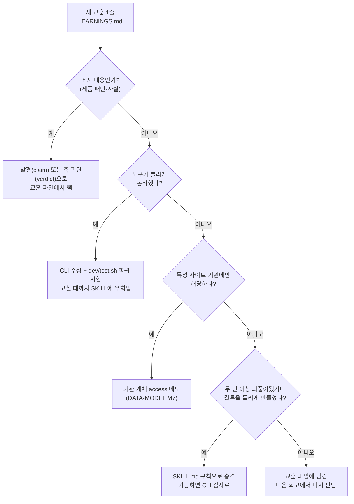
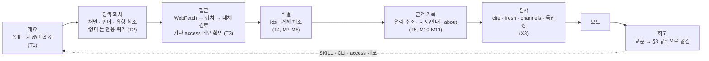

# 조사 방법론 재구성 (2026-11-13)

Issue #16. 관련 문서: `docs/DATA-MODEL.md` §9–§13(관계 모델), `docs/DECISIONS.md`, `docs/RESEARCH-FLOW-REDESIGN.md`, `skills/reference-research/SKILL.md`.

## 0. 목적

조사 중에 배운 것은 메인테이너 라이브러리의 `LEARNINGS.md`에 한 줄씩 쌓인다. 이 파일은 공개하지 않는다. 2026-11-13 기준으로 104줄이 쌓였다. 그런데 이 교훈이 스킬, CLI, 시험으로 옮겨졌는지는 따로 관리되지 않는다. 그래서 같은 실수가 여러 조사에서 되풀이되었고, 출처 접근 요령은 사이트 이름과 함께 흩어져 있다.

이 문서는 세 가지를 한다.

1. 쌓인 교훈을 방법 단위(주제)로 다시 묶는다.
2. 각 주제가 지금 어디에 반영되어 있는지(SKILL.md, CLI 검사, 반영 안 됨) 확인한다.
3. 앞으로 교훈이 쌓이면 어디로 옮길지 정하는 규칙과, 시험 방식을 정한다.

공개 저장소이므로 교훈은 날짜와 분류로만 가리킨다. 사이트 이름, 제품명, 조사 이름은 적지 않는다.

## 1. 쌓인 교훈 실측

집계 방법: `LEARNINGS.md`의 각 줄 `- <날짜> [<분류>] <내용>`에서 분류를 세었다.

| 분류 | 줄 수 | 성격 |
|---|---|---|
| `source` | 35 | 출처 접근·식별·근거 규율 |
| `process` | 32 | 조사 운영·도구 사용 |
| `capture` | 18 | 캡처 동작·결함 |
| `pattern` | 12 | 조사 **내용**(제품 패턴). 방법론이 아니다 |
| `search` | 7 | 검색 범위·쿼리 |
| 합계 | 104 | 방법론 교훈은 `pattern`을 뺀 92줄 |

SKILL.md 반영 여부는 키워드로 확인했다(`grep -c -i`). 결과는 각각 0회다.
- 시안(`A/B`, `시안`)
- 셸 전달(`heredoc`)
- 열람 수준(`snippet`, `not read`)
- 식별자(`doi`, `pmid`)
- 격리(`worktree`)

서브에이전트 언급은 1곳(§2 "사용자가 요청할 때만 나눈다")뿐이다.

## 2. 주제별 재구성

| # | 주제 | 교훈(날짜 [분류]) | 지금 반영된 곳 | 빠진 것 → 옮길 곳 |
|---|---|---|---|---|
| T1 | **목표·질문 설정** | 10-30 [process] ×2(요청을 목표로 옮기지 않기 · 지향과 피할 것 두 갈래, 적용 전 2~3장 시안으로 고르기), 11-04 [process](공식 가이드부터), 10-19 [process](직접 경쟁이 없으면 같은 문제를 푸는 다른 분야) | SKILL §1: 개요 질문, 회피 요청 사다리(2026-11-04 결정) | 디자인 방향은 시안으로 먼저 고르는 단계 → SKILL §1 |
| T2 | **검색 범위·쿼리** | 10-01 [search] ×2, 10-01 [process]("없다"는 전용 쿼리로 확인), 10-02·10-15·10-28·11-05·11-10 [search], 10-30 [process](출처 유형을 통째로 빼지 않기) | SKILL §2: 채널 표, 한국어 검색, "결과 0은 없다는 증거가 아님", `gap` 발견은 근거 세기 상한 보통 | 제외한 출처 유형은 1~2건 확인한 뒤 근거와 함께 기록 → SKILL §2 |
| T3 | **출처 접근 실패와 대체 경로** | `source`·`capture`의 사이트별 교훈 다수(403 · 봇 확인 · 클라이언트 렌더링 · PDF · 로그인 리다이렉트) | SKILL §2: "WebFetch가 막히면 캡처 먼저" 일반 규칙 1줄 | 사이트별 요령이 교훈 파일에만 있다 → **기관 개체의 `access` 메모**(DATA-MODEL M7). 같은 기관을 다시 만나면 `ref show`와 회차 시작 기준선에서 보이게 한다 |
| T4 | **출처 식별·독립성** | 10-15 [source](같은 논문이 여러 URL · 발행처는 저널명 · 같은 회사 여러 매체), 10-20 [process](abs·html·pdf 따로 들어옴), 11-09 [capture](잘못 붙은 제품명), 10-15 [process](`source add`가 기존 값을 덮어씀) | 다시 만난 자료 규칙(URL·별칭) | 식별자 키와 개체 해소 → DATA-MODEL M7·M8 |
| T5 | **근거 규율** | 10-30 [source](읽지 않은 출처 인용 금지), 10-27 [process](원문 미열람 표기 · 핵심 출처 2~3개 원문 대조), 11-09 [process] ×2(날짜는 페이지가 밝힌 것만 · 최신 2차 출처로 확인 보강), 10-02 [source](언어별 수치 불일치는 발견으로), 10-15 [source](국내 제품 사실은 공식 DB로), 11-10 [process](기존 출처 원문 다시 열기), 11-05·11-09 [process](자체 실측을 출처로 등록) | `ref cite`(인용 검사), `ref fresh`(12개월 신선도), 근거 세기 계산 | 열람 수준과 반대 출처 → DATA-MODEL M11, `ref cite`가 `snippet` 출처 인용을 경고 |
| T6 | **병렬 조사 운영** | 10-13 [process] ×2, 10-14·10-15·10-20·10-21 [process], 10-27 [process] ×2(검색 예산을 세션 단위로 공유 · 판단형 조사는 2개), 11-06 [process](서브에이전트 격리) | SKILL §2: "나누는 것은 비싸니 요청할 때만" | 실제로는 큰 조사마다 썼다. 운영 규칙 → SKILL 새 절: 에이전트 3개 이하 또는 검색 수 미리 나누기, 한국어 최소 횟수 명시, 출처 등록표 키, 내부 정본 먼저 대조, 쓰기 시험은 worktree |
| T7 | **CLI 사용 함정** | 10-01 [capture](셸 변수로 호출 실패), 10-13 [process](JSON 따옴표 → heredoc), 10-15 [process](.md 쓰기 막힘), 10-20 [source](`patent` 유형 없음 · `asOf` 형식, 한 건 오류로 배치 전체 거부), 10-21·11-10 [process](출력에서 S# 뽑기), 11-09 [process](`run start` 재실행) | 일부만 CLI에서 고침 | 도구 결함 → CLI 수정 + 회귀 시험(§4). 사용법 → SKILL 명령 표 |
| T8 | **캡처 동작** | 10-01 [capture] ×4(재시도 · 동의 배너 · 전체 페이지 스크린샷 · 긴 README), 10-02(일반 모달), 10-13(텍스트 레퍼런스 재캡처 시 중단), 10-30·11-04(PDF에서 중단), 11-05·11-10(메타만 남음 · 백엔드 전환) | 동의 배너 숨김은 고침(10-01 FIXED) | 알려진 중단 2건(텍스트 레퍼런스 재캡처, PDF) → 회귀 시험 후 수정. "프레임 없이 메타만" 결과를 캡처 직후 경고 |
| T9 | **안전·개인정보** | 10-27 [process] ×2(사용자 탭 닫음 · 관리 콘솔 마스킹), 10-28 [capture](로그인 아바타 찍힘), 10-15 [source](로그인 정보 화면 캡처 금지), 10-27 [process](User-Agent 위장 금지), 10-20 [process](약관 먼저) | 저장소 규칙: 읽기 전용 캡처(제출·가입·결제·동의 클릭 금지) | 로그인 흔적이 찍히는 사이트는 헤드리스 기본, 열어 둔 탭만 닫기 → SKILL 캡처 절과 `capture.mjs` |

## 3. 교훈을 옮기는 규칙

새 교훈을 기록할 때 아래 순서로 갈 곳을 정한다. 교훈 파일은 임시 보관함으로만 쓰고, 옮긴 줄에는 옮긴 곳을 적는다.

이 규칙은 SKILL §7(보고서·교훈·커밋)의 교훈 기록 절에 옮긴다. 회고 시점은 큰 조사(회차 3개 이상)가 끝날 때와 릴리스 전이다. 회고 때는 교훈 파일에서 아직 옮기지 않은 줄을 이 흐름으로 처리한다.

## 4. 시험 방식

### 4.1 지금 있는 것

| 시험 | 무엇을 보나 | 언제 |
|---|---|---|
| `dev/test.sh` | 문법, 매니페스트, doctor, Chrome 캡처, 보드, MCP. 임시 라이브러리에서 실행 | 코드 변경마다 |
| `dev/demo.sh` | 중립 주제 데모 보드와 README 스크린샷 | 보드 변경, 릴리스 |
| `ref cite` · `ref fresh` · `ref channels` · `ref delta` | 인용 id, 신선도, 채널 균형, 회차·조사·시간 변화 | 조사 중, 보고서 전 |
| 렌더링 스크린샷 확인 | 보드가 실제로 어떻게 보이나(여러 화면 폭) | 보드 변경 |
| 회고(postmortem) | 조사가 틀어진 원인(예: 2026-10-30 디자인 조사) | 피드백으로 재작업했을 때 |
| 자체 비교 실험 | 서브에이전트 방식 비교(11-06 교훈) | 방법을 바꿀 때 |

### 4.2 빠진 것과 제안

| # | 빠진 것 | 제안 | 관련 |
|---|---|---|---|
| X1 | 알려진 CLI 결함의 회귀 시험 | `dev/test.sh`에 고정 입력 추가: 텍스트 레퍼런스 재캡처, PDF URL, 따옴표가 든 발견 JSON, 라벨 속 `S`+숫자 | T7·T8 |
| X2 | 데이터 품질 재측정 | `DATA-MODEL.md` §2·§9 집계를 명령 하나로 다시 실행(예: `ref audit`)해 P1–P6과 관계 지표(개체 미연결, 식별자 없는 논문, `snippet` 인용)를 보인다. 이전 작업의 완료 기준이 된다 | DATA-MODEL §13 |
| X3 | 근거 규율 자동 검사 | `ref cite`가 `read: snippet` 출처만 인용한 줄과, 반대 출처가 있는 발견의 근거 세기를 경고 | T5, M11 |
| X4 | 개체 해소 검토 | 이전 작업에서 "검토 필요" 목록을 사람이 확인한 비율과 오합침 수를 기록 | T4, DATA-MODEL §11.1 |
| X5 | 방법 변경의 효과 측정 | SKILL 규칙을 바꾸면 다음 조사 2건에서 회차 수, 재작업 여부, 경고 수를 이전과 비교해 교훈 파일에 남김 | §3 |

## 5. 재구성한 조사 흐름

지금 SKILL.md의 흐름(개요 → 검색 회차 → 기록 → 검사 → 보드)에 이 문서와 관계 모델의 점검 지점을 더하면 아래와 같다.

## 6. 한계

- 주제 분류(§2)는 교훈 본문을 읽고 사람이 나눈 것이다. 한 줄에 교훈이 둘 이상 담기면 해당 주제마다 넣었으므로 주제별 개수의 합은 92보다 크다.
- SKILL 반영 여부는 키워드 검색으로 확인했다. 같은 뜻을 다른 말로 적은 규칙은 놓쳤을 수 있다.
- 교훈 파일은 2026-10-01부터 쌓였다. 그 전(스킬 v1)의 방법론은 `docs/DECISIONS.md` "Earlier"에만 남아 있다.
- 제안(§2의 "옮길 곳", §4.2)은 모두 별도 Task로 구현한다. 이 문서는 아무것도 바꾸지 않는다.
